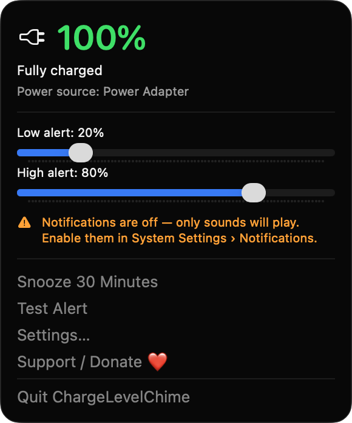
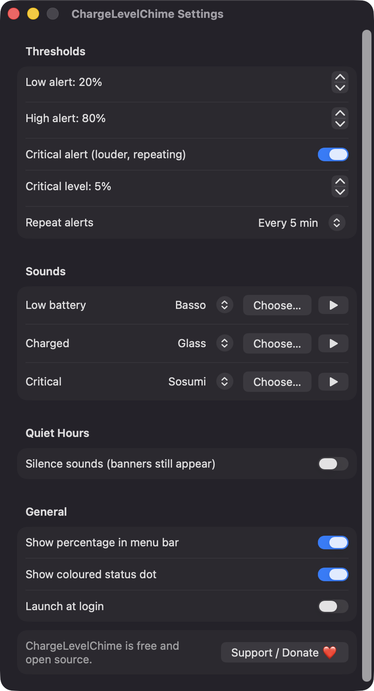
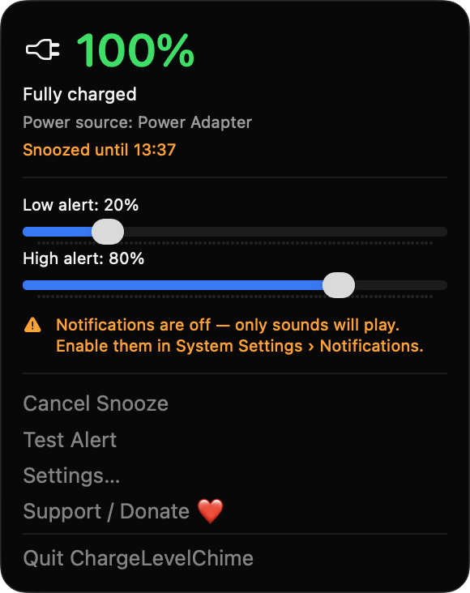

# ChargeLevelChime

**🌐 Website:** [turhe123.github.io/charge-level-chime](https://turhe123.github.io/charge-level-chime/)

Get a chime and a banner when your battery hits the low or full level you chose, so you plug in or unplug on time.


## Why

ChargeLevelChime is a free, open-source, 100% native, backend-free alternative to paid utilities in the *Battery & Power* category. It was inspired by Battery Charge Sound Alarm ($7.99 one-time), which showed there is real demand for this: macOS only warns you at very low battery levels, but many people want to keep their battery between roughly 20% and 80% for long-term health.

## Features

- **Menu bar app** showing a battery state icon (on battery, charging, plugged in) and, optionally, the percentage.
- **Colored status dot** in the menu bar: red at or below your low level, orange within 10% above it, green at or above your high level.
- **Low and high thresholds** (defaults 20% and 80%), adjustable with sliders right in the dropdown or with steppers in Settings. The two are kept at least 5% apart.
- **Low alert**: when running on battery and at or below the low level, plays a sound and posts a "plug in" banner.
- **High alert**: when on power and at or above the high level, plays a sound and posts an "unplug" banner. It also fires if the battery is already at 100% when your target is lower.
- **Critical alert** (default 5%, can be turned off): plays its sound three times and posts a Time Sensitive notification, repeating every 2 minutes at most.
- **Repeat interval**: only once, or every 1, 2, 5, 10, 15 or 30 minutes until the situation is resolved.
- **Hysteresis**: each alert fires once per crossing and re-arms after the battery moves 2% back across the threshold.
- **Quiet hours** (default 22:00–07:00, off by default): silences sounds but keeps banners. Windows that wrap past midnight are supported.
- **Snooze for 30 minutes** (and Cancel Snooze) from the dropdown.
- **Test Alert** button to hear and see what an alert looks like.
- **Sound pickers** for low, charged and critical alerts, populated from `~/Library/Sounds`, `/Library/Sounds` and `/System/Library/Sounds`, with a preview button and a "Choose…" option for your own audio file.
- **Live status** in the dropdown: percentage, charging state, power source, and time remaining or time until full when macOS provides an estimate.
- **Instant updates** through IOKit power source notifications, with a one-minute fallback timer and a re-check 5 seconds after wake from sleep.
- **No startup blast**: alerts are held for 90 seconds after launch, so a threshold already crossed at launch only alerts if it still applies afterwards.
- **Graceful fallbacks**: a "No battery found" state on Macs without a battery, and an in-menu warning if notifications are denied (sounds still play).
- **Launch at login** via `SMAppService`.

## Screenshots

<p align="center"></p>

<p align="center"><em>The menu bar dropdown shows the current charge, power source and the low/high alert sliders, with Snooze, Test Alert and Settings one click away.</em></p>

<p align="center"></p>

<p align="center"><em>Settings lets you fine-tune thresholds, the critical alert, repeat interval, per-alert sounds, quiet hours and menu bar options.</em></p>

<p align="center"></p>

<p align="center"><em>Snoozing silences alerts for 30 minutes and the dropdown shows when the snooze ends, with a Cancel Snooze option.</em></p>

## Install

1. Download `ChargeLevelChime-macOS.zip` from the [latest release](https://github.com/turhe123/charge-level-chime/releases/latest).
2. Unzip it and move `ChargeLevelChime.app` to `/Applications`.
3. Because the app is open source and not notarized, clear the quarantine flag:

   ```bash
   xattr -cr /Applications/ChargeLevelChime.app
   ```

4. The first time, right-click the app and choose **Open**.

Requires macOS 14.0 or later.

## Build from source

```bash
brew install xcodegen
xcodegen generate
xcodebuild -project ChargeLevelChime.xcodeproj -scheme ChargeLevelChime -configuration Release -derivedDataPath ./build build
```

The app is produced at `build/Build/Products/Release/ChargeLevelChime.app`.

## Permissions

ChargeLevelChime asks for very little:

- **Notifications**: requested on first launch (alerts and sounds) so it can show the low, full and critical battery banners. If you decline, sounds still play and the dropdown shows a warning.
- **Login item** (optional): only if you turn on "Launch at login" in Settings.
- **File access** (optional): only to the audio file you pick via "Choose…" for a custom sound, through the standard open panel.

It does **not** request Accessibility, Screen Recording, Microphone, Location or network access. Battery data is read with IOKit, which needs no permission.

## Built with AI

ChargeLevelChime was written by [Claude Code](https://claude.com/claude-code) inside an automated pipeline, from a plain-English spec. No code, binaries or assets from any commercial app were used; it is a clean-room reimplementation of a feature set, not a copy.

What that means in practice:

- The full source is in this repo under the MIT license. Read it before you run it.
- No network calls, no analytics, no third-party dependencies. Only Apple frameworks.
- Ad-hoc signed and not notarized, which is why Gatekeeper warns on first launch.
- It has had less human review than a hand-written app. Bug reports and pull requests are welcome.

## Support ❤️

If this app saves your battery, you can support its development:

[Support Or (Leo) Davidai ❤️ on Ko-fi](https://ko-fi.com/leodavidai)

There is also a "Support / Donate ❤️" button in the app's menu and Settings window.

## License

MIT © Or Davidai Bachar
